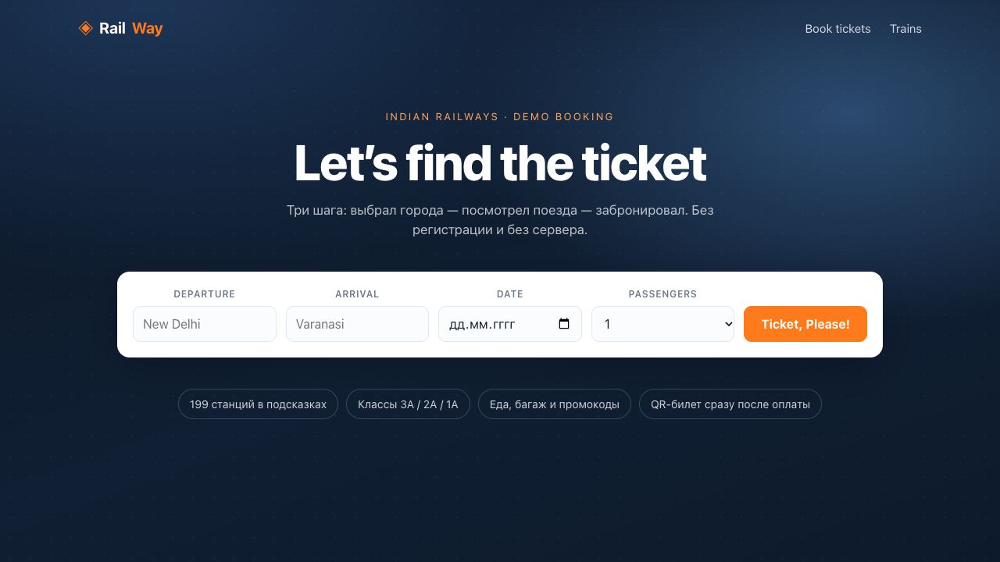
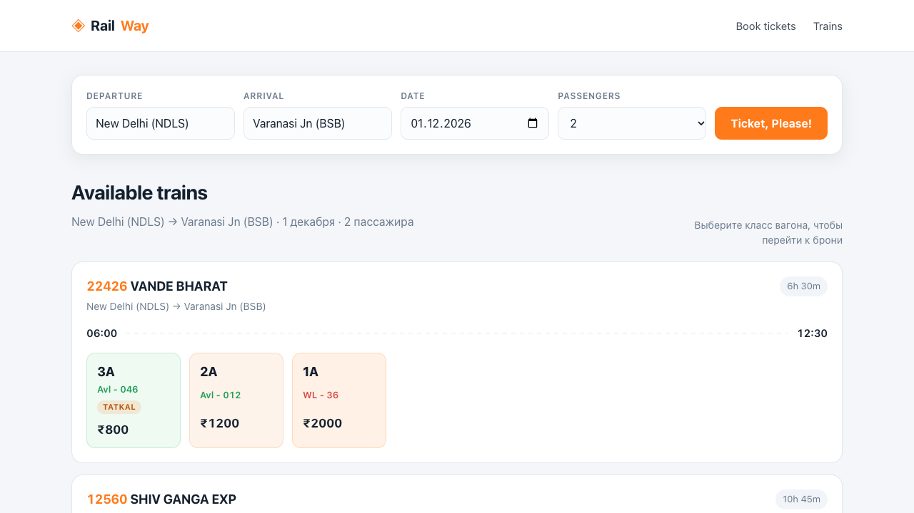
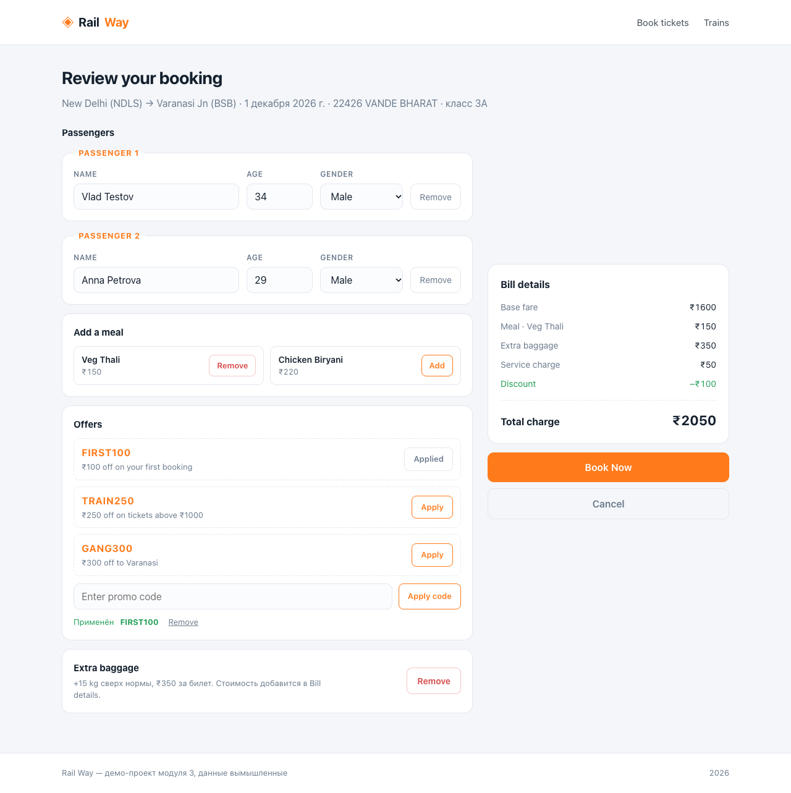
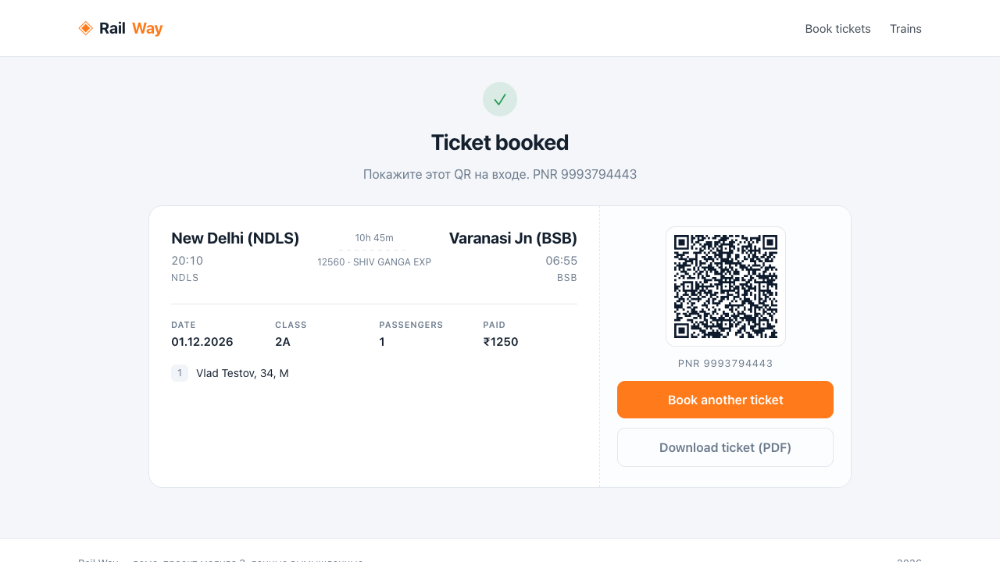

# Rail Way — каркас проекта модуля 3

Проект по ТЗ «Railway Ticket Booking» из `lectures_video/module_3_React/Проект/Project M3-1.md`:
бронирование билетов на индийские поезда, React + TypeScript + Redux Toolkit + React Router.

Это **рабочий каркас**: весь сценарий проходится от главной до билета с QR. Стили — моя версия,
не пиксель-в-пиксель по Figma. Логика брони, подсчёт билла и навигация уже готовы — осталось
подогнать вид под макет и добавить то, что захочешь сверх ТЗ.

## Быстрый старт

```bash
cd railway-ticket
npm install        # уже установлено, но если переносишь папку — нужно
npm run dev        # http://localhost:5173
npm run build      # проверка типов + прод-сборка (проходит без ошибок)
```

## Что уже работает

Полный сценарий проверен в браузере, скриншоты — в `screenshots/`:

1. **Главная** — форма поиска, 199 станций в подсказках из массива ТЗ, дата, число пассажиров.
2. **`/search-results`** — шапка с выбранными городами и датой, три поезда, у каждого классы 3A/2A/1A
   со статусом AVL/WL, Tatkal и ценой. По ТЗ список статичный — от городов не зависит.
3. **`/review-booking`** — столько форм пассажиров, сколько выбрано на главной; еда, промокод
   (новый заменяет старый), доп. багаж; `Bill details` пересчитывается на каждое действие.
4. **`/payment`** — сводка брони, три способа оплаты, кнопка Pay (заглушка вместо шлюза).
5. **`/success`** — билет с PNR, QR-кодом, пассажирами и суммой; «Book another ticket» сбрасывает
   бронь, «Download ticket (PDF)» открывает печать страницы.
6. **404** — на любой неизвестный адрес.






## Структура

```
src/
├── types/
│   ├── train.ts            Train, TrainClass, TrainStop
│   └── booking.ts          Passenger, Meal, Promo, BookingState + константы
├── store/
│   ├── store.ts            configureStore, ключи TrainsSearchResults и Booking
│   ├── hooks.ts            useAppDispatch / useAppSelector
│   ├── selectors.ts        selectBill — весь подсчёт суммы в одном месте
│   ├── data/
│   │   ├── stations.ts     199 станций из ТЗ
│   │   ├── trains.ts       три поезда-заглушки
│   │   └── offers.ts       еда и промокоды
│   └── slices/
│       ├── searchResults.ts
│       └── booking.ts      setSearch, selectTrain, passengers, meal, baggage, promo
├── pages/                  Home, SearchResults, ReviewBooking, Payment, Success, NotFound
├── components/             Header, Footer, TicketSearchForm, TrainCard, TrainCardContainer,
│                           ClassCard, PassengerForm, BillDetails, OffersList, MealBlock, BaggageBlock
├── App.tsx                 роуты, lazy + Suspense, скролл наверх
└── main.tsx                Provider + BrowserRouter
```

## Что сделано «как учили» (на это смотрят на консультации)

- Типы вынесены отдельно от данных и слайсов — `src/types`.
- Данные лежат в `src/store/data`, а не внутри компонентов.
- Ключи в сторе длинные и однозначные: `TrainsSearchResults`, `Booking`.
- Пропсы типизированы через `interface Props`, у карточки класса — `Train` и `TrainClass`.
- Каждому компоненту свой CSS-модуль, ни одного глобального класса внутри компонентов.
- Картинок нет, поэтому правило «импортируй переменной» пока не на чем проверить — если добавишь
  иконку/фон, импортируй, а не пиши путь строкой в `src`.
- Страницы грузятся лениво (`React.lazy` + `Suspense`) — тема лекции 27.10.
- Сумма считается селектором, а не в компоненте.

## Что осталось тебе

- [ ] Подогнать вёрстку под Figma: шрифты, отступы, цвета, картинка фона на главной.
- [ ] Проверка формы: сейчас обязательные поля только у поиска, пассажиры проверяются на «имя и возраст не пустые».
      По-взрослому — `react-hook-form` (её тема впереди).
- [ ] Адаптив: базовые брейкпоинты есть (860/900/720 px), но по макету надо досмотреть мобильный вид.
- [ ] PDF-билет: сейчас `window.print()`. Настоящий файл — `jsPDF` или `html2canvas`.
- [ ] Сохранение брони в `localStorage` — «возможность для расширения» из ТЗ.
- [ ] Продвинутый вариант из ТЗ: список станций из API + RTK Query (`createApi`, `fetchBaseQuery`).
- [ ] Свои версии главной и `/search-results` — если на консультациях ты писал их сам, замени здешние
      на свои, чтобы код был твой.

## Что нужно уметь объяснить

Каркас писал я, а не ты — на консультации ментор спросит «почему так», и вот что надо понимать,
а не просто иметь:

1. Почему `setSearch` создаёт пассажиров, а не главная страница (одно место правды о количестве).
2. Зачем `createSelector` в `selectors.ts` и что будет, если считать сумму прямо в `BillDetails`.
3. Почему новый промокод перезаписывает `discount`, а не прибавляется.
4. Зачем `Navigate`/проверка `if (!train)` на внутренних страницах — что будет при прямом заходе.
5. Почему `Train` в `types` отдельно от `store/data/trains.ts`.

Если на какой-то вопрос ответа нет — разбери файл построчно и перепиши под себя. Копипаста без
понимания на защите проекта видна сразу.
